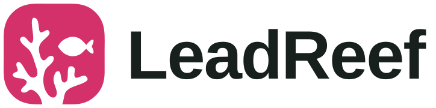

<p align="center">
  <a href="https://leadreef.ai/mcp">
    <picture>
      <source media="(prefers-color-scheme: dark)" srcset="assets/logo-white.svg">
      
    </picture>
  </a>
</p>

<h1 align="center">LeadReef MCP Server</h1>

<p align="center">
  Find local businesses with no website or a weak one, and read their contacts, from Claude, ChatGPT, Cursor and any other MCP client.
</p>

<p align="center">
  <a href="https://leadreef.ai/mcp">Website</a> ·
  <a href="https://leadreef.ai/mcp/docs">Technical reference</a> ·
  <a href="docs/clients.md">Setup for every app</a> ·
  <a href="docs/tools.md">Tools</a> ·
  <a href="https://leadreef.ai/pricing">Pricing</a>
</p>

<p align="center">
  <a href="https://cursor.com/en/install-mcp?name=leadreef&config=eyJ1cmwiOiJodHRwczovL2FwaS5sZWFkcmVlZi5haS9tY3AifQ=="></a>
  <a href="https://insiders.vscode.dev/redirect/mcp/install?name=leadreef&config=%7B%22type%22%3A%22http%22%2C%22url%22%3A%22https%3A%2F%2Fapi.leadreef.ai%2Fmcp%22%7D"></a>
</p>

---

**LeadReef MCP** is the official remote [Model Context Protocol](https://modelcontextprotocol.io) server for [LeadReef](https://leadreef.ai), a lead finder for web designers and agencies. Connect it once, and your AI app can scan a city for local businesses that have no website or a weak one, rank them by how much they need a new site, and pull the phone, email and address so the AI can write the pitch.

```
https://api.leadreef.ai/mcp
```

- **Nothing to install.** Remote server over Streamable HTTP. Paste the URL into your app.
- **Sign in with OAuth.** You sign in on leadreef.ai and click Allow. The AI app never sees your password.
- **Free to connect.** Works on every LeadReef plan, including Free (1 search a day). Reading leads, contacts and your balance costs nothing.
- **Read and search only.** A connected app cannot send messages, delete leads, change billing or publish sites.

## Quick start

| App | How to connect |
| --- | --- |
| **Claude** (web and desktop) | Customize → Connectors → + Add → *Add custom connector* → paste the URL. [Guide](https://leadreef.ai/mcp/claude) |
| **ChatGPT** (web) | chatgpt.com/plugins → + → *Add custom MCP server* → paste the URL, choose OAuth. [Guide](https://leadreef.ai/mcp/chatgpt) |
| **Claude Code** | `claude mcp add --transport http leadreef https://api.leadreef.ai/mcp`, then `/mcp` → Authenticate |
| **Cursor** | Click *Add to Cursor* above, or paste [`configs/cursor-mcp.json`](configs/cursor-mcp.json) into `~/.cursor/mcp.json`. [Guide](https://leadreef.ai/mcp/cursor) |
| **VS Code** (Copilot agent mode) | Click *Install in VS Code* above, or use [`configs/vscode-mcp.json`](configs/vscode-mcp.json) |
| **Gemini CLI** | `gemini extensions install https://github.com/LeadReef/leadreef-mcp`, then `/mcp auth leadreef` |
| **Codex** | Add [`configs/codex-config.toml`](configs/codex-config.toml) to `~/.codex/config.toml`, then `codex mcp login leadreef` |
| **Devin Desktop** | `devin mcp add leadreef https://api.leadreef.ai/mcp`, then `devin mcp login leadreef` |
| **Mistral Vibe** | Work → Connectors → + Add Connector → *Custom MCP Connector* → paste the URL |

Step-by-step instructions for each app: [docs/clients.md](docs/clients.md).

### Claude Code plugin

This repository is also a Claude Code plugin with the server and a ready-made workflow skill:

```
/plugin marketplace add LeadReef/leadreef-mcp
/plugin install leadreef@leadreef
```

## What you can ask

- "Find 20 dentists in Austin with no website and rank them by how much they need one."
- "Which of my saved leads have 4.5+ stars on Google but no site?"
- "Show my leads from the Lisbon search that have a phone number."
- "Get the email and phone for Bella Vista Trattoria."
- "Take the top 5 restaurants from my Manchester search and write each a 3-line cold email."
- "How many credits do I have left this month?"

More, with the tools each prompt uses: [docs/examples.md](docs/examples.md).

## Tools

Nine tools. Only `start_search` spends anything; every other tool is free.

| Tool | What it does | Cost |
| --- | --- | --- |
| `get_account` | Your plan, credit balance and free searches left today | Free |
| `list_supported_free_searches` | Business type and city pairs the Free plan can search | Free |
| `estimate_search` | What a search would cost and whether your account can run it | Free |
| `start_search` | Starts a search for businesses with no website or a weak one | Credits, or the daily free search |
| `get_search` | Status of a search and its leads, best opportunities first | Free |
| `list_searches` | Your past searches, newest first | Free |
| `list_leads` | Saved leads across searches, with filters | Free |
| `get_lead` | One lead's card: what is wrong with its site and what to pitch | Free |
| `get_lead_contacts` | One lead's phone, email, address and social profiles | Free |

Parameters, return fields, scopes, rate limits and error codes: [docs/tools.md](docs/tools.md).

## Pricing

The MCP server is included in every LeadReef plan. A search costs the same credits as in the LeadReef app, from the same balance.

| Plan | Price | What you get |
| --- | --- | --- |
| Free | $0 | 1 search a day, up to 10 leads, 10 business types × 10 cities |
| Starter | $14/month | 60 credits |
| Pro | $49/month | 250 credits, Recent Ads and Open Web lead sources, extended searches |
| Scale | $99/month | 600 credits |

A standard search costs from 2 credits. Current prices: [leadreef.ai/pricing](https://leadreef.ai/pricing).

## Security and privacy

- **OAuth 2.1 with PKCE.** You sign in on leadreef.ai and approve the app there. Tokens go in the `Authorization` header, never in the URL.
- **Two scopes.** `leads:read` reads searches, leads, contacts and the account. `leads:search` runs searches, which spend credits.
- **Disconnect in one click.** Settings → Connected apps in LeadReef lists every app with its last use. Disconnect ends access at once.
- **No outbound actions.** LeadReef never sends emails or SMS. You send every message yourself.

Report a security issue: see [SECURITY.md](SECURITY.md). Privacy policy: [leadreef.ai/privacy](https://leadreef.ai/privacy).

## FAQ

**What is the LeadReef MCP server?**
A remote MCP server that lets AI apps use LeadReef: search a city for local businesses with no website or a weak one, read the leads and their contacts, and check your credit balance. You connect it with one URL and sign in on leadreef.ai.

**Do I need to install anything?**
No. It is a hosted server at `https://api.leadreef.ai/mcp`. There is no package to run, no API key to copy and nothing to self-host.

**Is it free?**
Connecting is free on every plan. Reading leads, contacts and your balance is free. A search uses credits, or the daily free search on the Free plan.

**Can the AI send emails or change my account?**
No. A connected app can read your searches, leads, contacts, plan and balance, and run searches. It cannot send messages, delete leads, change billing or publish sites.

**Which apps work with it?**
Claude, ChatGPT, Claude Code, Cursor, VS Code with Copilot, Gemini CLI, Codex, Devin Desktop, Mistral Vibe, and any other client that supports remote MCP servers with OAuth sign-in.

**Which countries and business types can I search?**
Paid plans search any business type in any city. The Free plan searches a fixed list of pairs; ask the AI to run `list_supported_free_searches` to see them.

**Is this repository the server source code?**
No. The server is hosted by LeadReef. This repository holds the public documentation, client configs, a Claude Code plugin, a Gemini CLI extension and registry metadata.

## About this repository

| Path | What it is |
| --- | --- |
| [`server.json`](server.json) | Entry for the [Official MCP Registry](https://registry.modelcontextprotocol.io) |
| [`.mcp.json`](.mcp.json) | MCP config for Claude Code and the plugin |
| [`.claude-plugin/`](.claude-plugin) | Claude Code plugin and marketplace manifest |
| [`gemini-extension.json`](gemini-extension.json), [`GEMINI.md`](GEMINI.md) | Gemini CLI extension |
| [`AGENTS.md`](AGENTS.md) | Instructions for Codex and other agents that read AGENTS.md |
| [`skills/find-leads/`](skills/find-leads/SKILL.md) | Workflow skill: estimate, search, review leads, write the pitch |
| [`configs/`](configs) | Ready-to-paste configs for Cursor, VS Code, Codex, Gemini CLI and Devin |
| [`docs/`](docs) | Setup guides, tool reference and example prompts |
| [`glama.json`](glama.json) | Maintainer metadata for Glama |

## Support

- Email: [support@leadreef.ai](mailto:support@leadreef.ai)
- Issues with the docs or configs in this repository: [open an issue](https://github.com/LeadReef/leadreef-mcp/issues)
- Free AI skills for web designers: [leadreef.ai/ai-tools](https://leadreef.ai/ai-tools)
- Free tools for web designers: [leadreef.ai/tools](https://leadreef.ai/tools)

## License

The documentation and configuration files in this repository are released under the [MIT License](LICENSE). The LeadReef service is covered by the [LeadReef Terms](https://leadreef.ai/terms).
